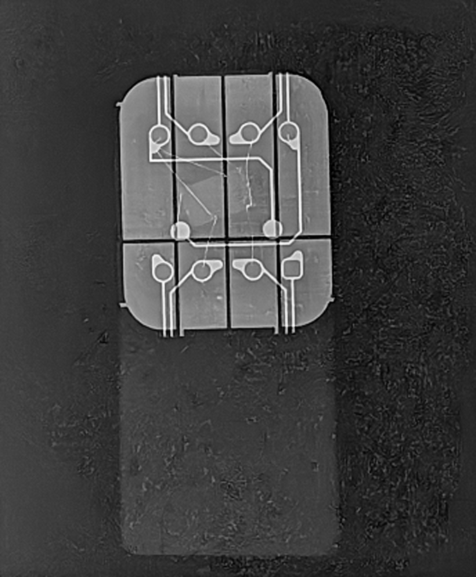
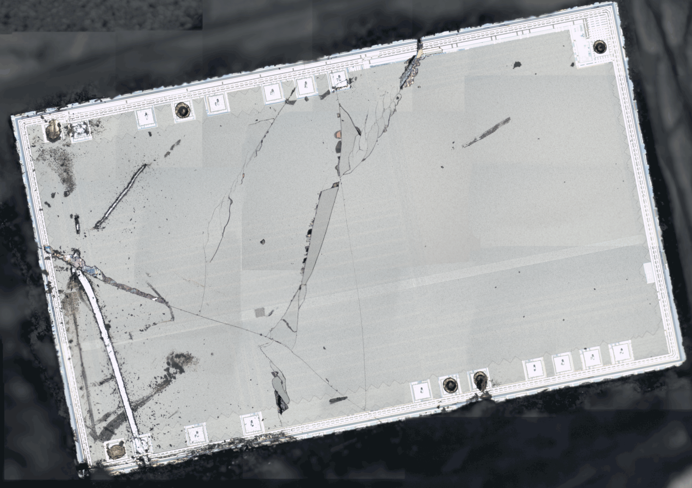
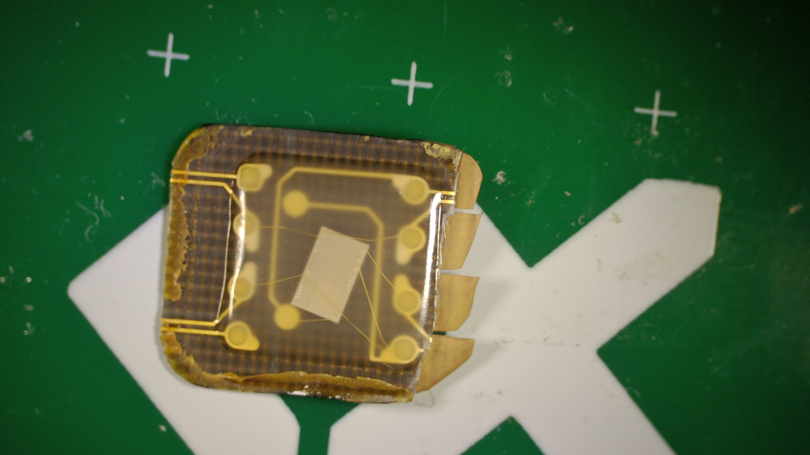
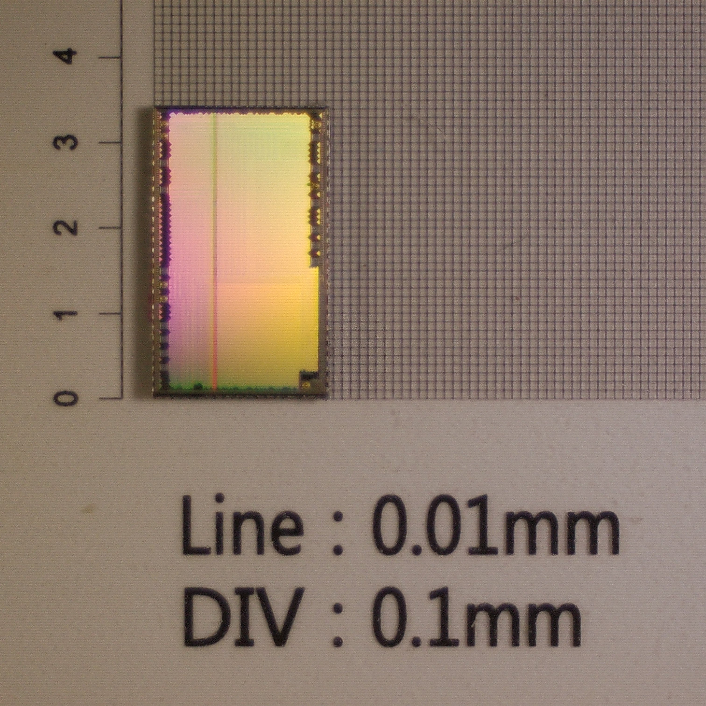
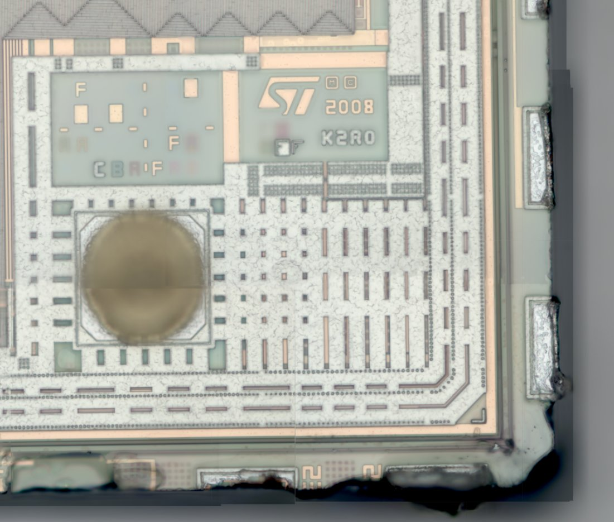
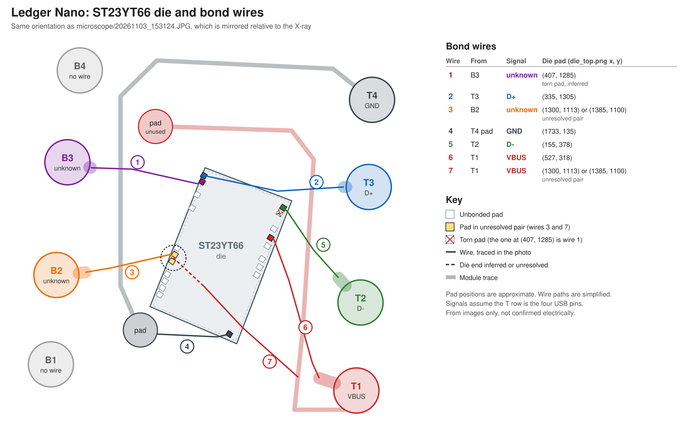

# Ledger Nano reverse engineering

Reverse engineering of the original Ledger Nano, a legacy product with no
display. It runs on an STMicroelectronics ST23YT66 connected directly to USB.

## Chip

Facts from the ST23YT66 data brief (ST Doc ID 15120 Rev 2, December 2010). The
document is copyrighted by ST and is deliberately not stored in this repo.

| Feature  | Value                                                         |
| -------- | ------------------------------------------------------------- |
| Package  | TSSOP20, which matches the 20 pad openings on the die          |
| Supply   | 3 V to 5.5 V, 0 to 70 C                                        |
| CPU      | ST23 8/16-bit, up to 29 MHz                                    |
| Memory   | 210 KB user ROM, 6.2 KB RAM, 2 KB NESCRYPT RAM, 66 KB EEPROM   |
| USB      | Full-speed USB 2.0 with clock recovery                         |
| SPI      | 10 MHz master                                                  |
| GPIO     | 12 pins: 7 bidirectional, 5 input-only                         |
| Security | Active shield, environment monitoring, fault protection, TRNG  |

The brief has no pinout. Its block diagram shows the clock generator, IART, GPIO
and SPI sharing "multiplexed pins", while USB has its own analog transceivers.

### Pin budget

This is a working hypothesis, not a pinout:

- `VCC`, `GND`, `D+` and `D-` take 4 pins, which leaves 16.
- The other 16 must carry 12 GPIO plus SPI, IART, `XIN`, `XOUT` and probably a
  reset, so at least some of these must share pins.
- SPI needs at least one input and two outputs. The outputs (`MOSI` and `CLK`)
  cannot use the 5 input-only GPIO. The brief describes reading a companion serial
  flash for AutoPlay, so `MISO` is probably present.
- Only 7 of the 20 pads are bonded in the Nano, on 6 separate nets. USB and power
  need 4 of those nets, which leaves at most 2 for anything else. The remaining
  13 pads are not connected to the module.

## USB identity

Read from a working device with `lsusb -v` and sysfs. Only standard USB descriptor
and status requests were used, and no HID reports were sent.

| Field               | Value                                                |
| ------------------- | ---------------------------------------------------- |
| VID:PID             | `2581:3b7c` (`usb.ids` vendor name: Plug-up)         |
| Strings             | Manufacturer `Ledger`, product `Ledger Wallet`       |
| Serial string       | `0000`                                               |
| Speed               | Full speed, USB 2.00, `bcdDevice` 0.00               |
| EP0                 | 16 bytes                                             |
| Interface           | One HID interface, HID 1.01                          |
| Data endpoints      | `0x82` IN and `0x02` OUT, interrupt, 64 bytes, 1 ms  |
| Configuration       | `bmAttributes` 0xc0 (self-powered), `MaxPower` 100 mA |

The 16-byte EP0 and the 64-byte endpoints on EP2 match the buffer sizes in the data
brief. `bmAttributes` claims self-powered although the device runs from the bus,
and `GET_STATUS` reports bus-powered.

HID report descriptor (34 bytes):

```text
06 a0 ff        Usage Page (vendor 0xFFA0)
09 01           Usage (0x01)
a1 01           Collection (Application)
09 03             Usage (0x03)
15 00             Logical Minimum (0)
26 ff 00          Logical Maximum (255)
75 08             Report Size (8)
95 40             Report Count (64)
81 08             Input (Data, Array, Absolute, Wrap)
09 04             Usage (0x04)
15 00             Logical Minimum (0)
26 ff 00          Logical Maximum (255)
75 08             Report Size (8)
95 40             Report Count (64)
91 08             Output (Data, Array, Absolute, Wrap)
c0              End Collection
```

The transport is therefore raw 64-byte vendor reports in each direction, with no
report IDs.

GET FIRMWARE VERSION on this unit (`tools/get_firmware_version.py`):

| Field        | Raw    | Value                                   |
| ------------ | ------ | --------------------------------------- |
| Features     | `01`   | Compressed public keys, no other flags  |
| Architecture | `20`   | Meaning not documented                  |
| Firmware     | `01 00 01` | 1.0.1                               |
| Loader       | `01 10` | 1.16 in decimal, or 1.10 if the byte is meant as hex |
| Status word  | `90 00` | Success                                 |

GET OPERATION MODE (`tools/get_operation_mode.py`) returned status `6985` for both
the operation mode and second factor queries. The spec documents this command as
available after setup, and does not list `6985`. This fits the unit's history: it is
brand new and has never been set up.

The framing and commands are summarised in [Host protocol](docs/protocol.md).
See [Firmware updates](docs/firmware.md) for newer firmware.

Electrum lists `2581:3b7c` as "HW.1 Ledger production". See
[Plug-up research notes](docs/plug-up.md) for the vendor ID and its history.

## X-ray imaging



`xray/202610260220940004_20261103013.png` (688 x 834 px, no scale reference)

Initial observations from the image, not yet checked against the physical device:

- The module has eight contact segments, in two rows of four.
- Each segment has a round or rounded landing point, and traces run off the top
  and bottom edges of the module.
- Two more round features sit near the centre, just above the split between the
  two rows.
- Seven thin bond wires run from the contacts and one round feature to the die.
  See [Bond wire map](#bond-wire-map).
- A fainter rectangular shape extends below the module.

## Die photo



`microscope/die_top.png` (2000 x 1412 px, no scale reference)

Optical microscope image of the die, which appears to be stitched from several
fields. It is mirrored relative to the X-ray. To compare them, flip it
horizontally:

```sh
magick microscope/die_top.png -flop die_top_flopped.png
```

The die was extracted mechanically with a knife, not chemically. The cracks,
gouges and missing fragments on its surface come from that extraction, so they
are not device features.

Six bond sites are clearly visible, out of 20 pad openings along the two long
edges. The wire map below indicates a seventh on a damaged pad.

## Wires through the compound



`microscope/20261103_153124.JPG` (5376 x 3024 px, RaySmart VMS700, no scale
reference)

This view shows the wires and the die through the transparent compound. It has
the same handedness as `die_top.png`, so it is only rotated relative to that
photo and mirrored relative to the X-ray.

`microscope/die_overlay.png` shows `die_top.png` warped onto this view. The
warp uses hand-picked die corners. The pad positions line up with the pale pad
openings visible on the die, including the group of four. The 180-degree
alternative puts that group at the wrong end of the die, so it was rejected.

## Die size



`microscope/die_scale.jpg` (3024 x 3024 px; source:
<https://x.com/MagicalTux/status/2117577532845502839>, 2026-11-03) shows the die on a
grid with 0.1 mm divisions.

The project owner gives the size as about **3.4 x 2 mm**. A grid-based measurement in
this photo agrees within the error from the die's dark border: the calibration grid
resolves to about 37 px per 0.1 mm, and the bright active area measures roughly
3.2 x 1.7 mm, with the true outer edge a little larger.

Taking 3.4 mm for the long edge, and the pad count of 10 openings along each long edge
from the die photos, the pad pitch is on the order of 0.3 mm. This is a rough estimate,
not a measured pitch.

## Die markings and higher-resolution photos

Three cleaner photos of an extracted die (source: the project owner's post,
<https://x.com/MagicalTux/status/2117575204692218102>, 2026-11-03):

- `microscope/die_on_carrier.jpg` - die resting on a green carrier, diffraction colours.
- `microscope/die_clean.jpg` - the die alone, with the pad ring and bond balls visible.
- `microscope/die_corner_markings.jpg` - top-right corner at high magnification.



The corner carries etched identification, which confirms the die is an ST part:

| Marking | Reading                                                             |
| ------- | ------------------------------------------------------------------ |
| Logo    | STMicroelectronics "ST" logo                                        |
| `2008`  | Likely a mask or design year                                        |
| `K2R0`  | A mask or product code, exact meaning unknown                       |

Near the logo is a block of small test or alignment labels (single letters such as
`F`, `I`, `C`, `B`), and a large circular pad, probably a bonding or probe pad. A
dense column of fingers runs down from the corner toward the pad ring. These are
visual readings from one photo and have not been cross-checked.

The die has a hatched metal top layer (seen as the zig-zag border), consistent with
the active shield listed in the data brief.

## Bond wire map



`diagrams/bond_map.svg` is generated by `diagrams/gen_bond_map.py`. Its geometry
follows `20261103_153124.JPG`, with simplified wire paths.

Contacts are named by their position in the X-ray as stored: `T1` to `T4` along
the top row and `B1` to `B4` along the bottom row, each numbered left to right.
In `20261103_153124.JPG`, the right column reads `T1` to `T4` from bottom to top,
and the left column reads `B1` to `B4` from bottom to top.

Die pad coordinates are approximate pixel positions in the unflipped
`die_top.png`.

| Wire | From                 | Die pad (x, y) | Pad appearance                     | Confidence |
| ---- | -------------------- | -------------- | ---------------------------------- | ---------- |
| 1    | `B3`                 | (407, 1285)    | Torn up, no bond visible           | Inferred   |
| 2    | `T3`                 | (335, 1305)    | Brown residue                      | Good       |
| 3    | `B2`                 | See below      | Dark bond ball                     | Pair only  |
| 4    | Pad connected to `T4` | (1733, 135)   | Dark bond ball                     | Good       |
| 5    | `T2`                 | (155, 378)     | Brown residue                      | Good       |
| 6    | `T1`                 | (527, 318)     | Dark bond ball                     | Good       |
| 7    | `T1`                 | See below      | Dark bond ball                     | Pair only  |

- Wires 3 and 7 land on the adjacent pads at (1300, 1113) and (1385, 1100). The
  images do not show which wire goes to which pad.
- Wire 1 reaches the die where the knife damage crosses the pad at (407, 1285).
  That is why only six sites are visible in the die photo.
- The torn pad at (232, 378) has no visible wire.
- `T1` has two bond wires, and `B1` and `B4` have none. `T4` has no direct wire
  and reaches the die through its module pad.
- The two round features are plain module pads. The one connected to `T1` is
  unused, and the one connected to `T4` carries wire 4.

This map is from images; of the nets, only `B2` and `B3` have since been probed
electrically (see [Exposed contacts under power](#exposed-contacts-under-power)).

## Contact signals

The module plugs directly into a USB-A slot, with the plug upside down, so its
contacts are the USB pins. `VCC` feeds two die pads. The two other exposed
contacts with bond wires land on die pads next to the `D+` and `VCC` pads.

| Contact | Signal    | Wires | Basis                                             |
| ------- | --------- | ----- | ------------------------------------------------- |
| `T1`    | `VBUS`    | 6, 7  | Only contact with two wires                       |
| `T2`    | `D-`      | 5     | USB pin order along the `T` row                   |
| `T3`    | `D+`      | 2     | USB pin order, and its pad neighbours wire 1      |
| `T4`    | `GND`     | 4     | USB pin order; wire 4 bonds to its module pad     |
| `B2`    | High + ~10 MHz | 3 | At VBUS (~4.97 V) with a small clock; see below   |
| `B3`    | High + ~10 MHz | 1 | ~0.2 V below VBUS (~4.75 V) with a small clock; see below |
| `B1`    | None      | None  | No bond wire                                      |
| `B4`    | None      | None  | No bond wire                                      |

The assignment assumes the `T` row is the four USB pins. The only two adjacent
bonded pad pairs on the die are wires 2 and 1, and wires 7 and 3, which matches
the adjacency described above.

Open questions:

- Which of wires 3 and 7 lands on (1300, 1113) and which on (1385, 1100).
- Why `VCC` has two pads. Wire 7 crosses the whole die to reach its pad, so that
  pad seems to be needed specifically. It may be a second supply, or a tied-off
  input such as an active-low reset. `B2` (wire 3, pad near the `VCC` pad) sits
  at the VBUS rail, which may be related.
- Whether the ~10 MHz seen on `B2` and `B3` is a driven clock output or internal
  clock activity coupling onto otherwise pulled-up pins, and the function of
  these two contacts.

## Exposed contacts under power

The two unexplained contacts `B2` and `B3` were probed with a Rigol DHO924S
(12-bit, 250 MHz) while the device was plugged into USB. `B2` is the exposed
contact farther from `GND`; `B3` is the one nearer `GND`.

Both pins sit near 0 V when the device is unplugged and rise when it is powered:

| Contact             | DC level, powered          | Small-signal content         |
| ------------------- | -------------------------- | ---------------------------- |
| `B2` (far from GND) | ~4.97 V, at the VBUS rail  | continuous ~10 MHz, ~1.6 mVpk |
| `B3` (near GND)     | ~4.75 V, ~0.2 V below VBUS | continuous ~10 MHz, ~0.8 mVpk |

Riding on that DC level, both contacts carry a small, continuous, narrow-band
clock. Captured AC-coupled at 625 MSa/s, the fundamental is a sharp spectral line
150-260x above the noise floor, with a flat envelope over the capture (steady,
not bursty) and a harmonic family near 13, 16 and ~29 MHz. The fundamental is
not fixed: separate captures place it at 9.6, 10.1 and 10.4 MHz. That
few-percent wander is characteristic of an on-chip RC oscillator rather than a
crystal, which fits the absence of any bonded crystal pins and the chip's USB
clock recovery.

Two of these frequencies match the data brief: ~10 MHz is the master SPI rate,
and ~29 MHz is the maximum CPU clock. The amplitude is only ~1-2 mV at the probe,
so this reads as internal clock activity coupling onto high-impedance pins rather
than a driven clock output, though probe loading could also attenuate a real
output. The signal is stronger on `B2`.

Method note: the clock is far below the vertical resolution at a scale that shows
the 5 V rail, so a hardware frequency counter and edge trigger cannot lock onto
it. It is recovered by AC-coupling to remove the rail, zooming to ~10 mV/div, and
taking an FFT, which pulls the periodic line out of the quantisation floor.
